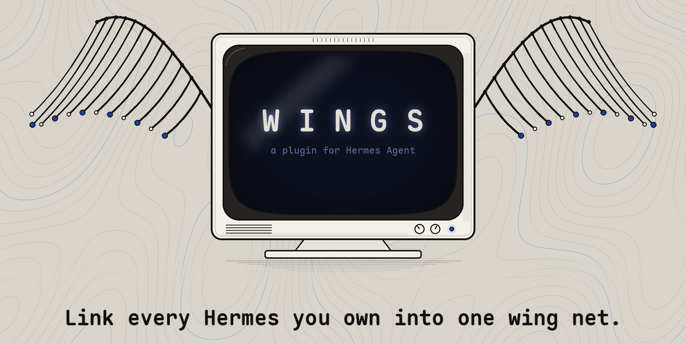
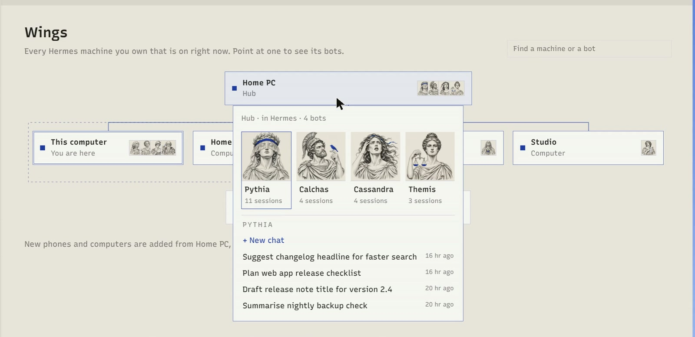
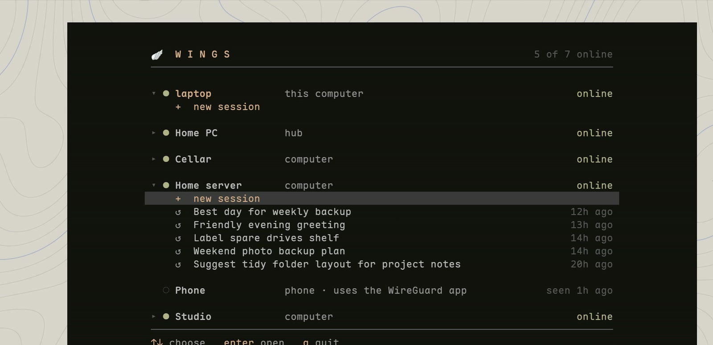
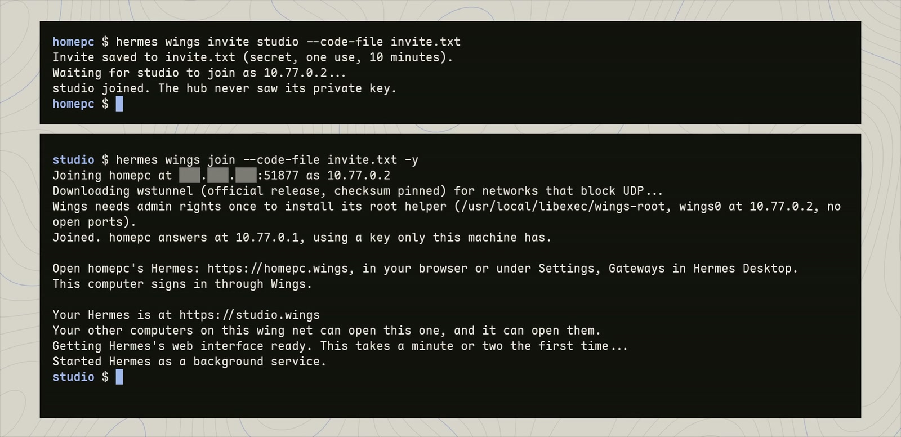
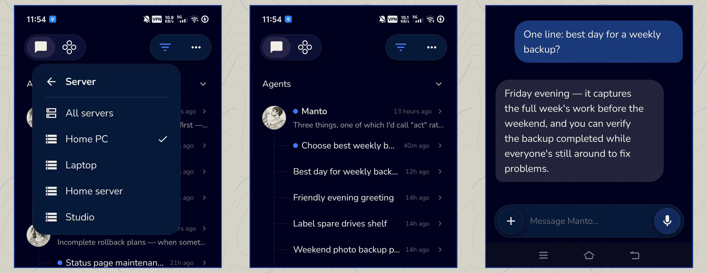

<p align="center"></p>

**Link every Hermes you own, and your phone, into one wing net.**

**Demo video (85 seconds):** https://x.com/E_Shiz/status/2120602196282941808

Wings is a plugin for Hermes Agent. It makes a private network between your own devices. After that, every machine that is switched on shows up, with its bots and sessions, in Hermes Desktop, in the terminal and in the Hermes app.

It uses WireGuard, a widely used VPN (a way to join devices into one private network over the internet). There is no account to make and no third-party service.

## What you need

- **Two devices are enough: a computer that runs Hermes, and your phone.** Nothing else is involved.
- The computer you run `hermes wings setup` on is called the hub. Your phone, and any computers you add later, connect to it.
- Any Linux computer can be the hub: your only computer, a home server, an old PC or a cloud server (a VPS).
- If you have a machine that stays on all the time, make it the hub. That is the best setup, because phones and new devices connect through the hub. If you do not, use the computer you most want to reach: the wing net then works whenever that computer is on.
- To reach a hub at home from outside your home, one UDP port has to be forwarded on your router, the same as for any WireGuard tunnel into your home. A VPS already has a public address.
- On a phone, the free WireGuard app.

## How it works

- Run `hermes wings setup` on one computer. That computer is now the hub.
- To add your phone, scan one QR code with the WireGuard app. The phone now talks to that computer alone.
- To add another computer, run `hermes wings invite <name>` on the hub, then `hermes wings join` on the new one.
- Computers link directly to each other when their networks allow it. The hub introduces them, and carries their traffic when they cannot link directly. A phone always connects to the hub.
- Some networks block UDP, which WireGuard needs. There, Wings falls back to wstunnel, which sends the same traffic over HTTPS on port 443.
- Nothing runs outside your own machines.

## With more than two devices: what the hub does

The hub is needed to add a device, for phones, and for any pair of computers that cannot link directly. Computers that are already linked directly keep talking while it is off.

We tested this on Nov 11 2026 by cutting the hub off for four minutes. Two computers that already had a direct link kept reaching each other, in both directions, the whole time. Machines with no direct link could not be reached, and neither could the hub itself. When it came back, everything returned by itself within 40 seconds.

## Why you might want it

- Run a local model on the GPU at home, and use it from a laptop or phone somewhere else.
- Open a long-running session on your home machine from a different computer, and pick it up where it was.
- See all your bots in one list, whichever machine they live on.

## How it differs from the Tailscale and Headscale plugins

Those plugins need a Tailscale account or a control server. Wings is plain WireGuard with one of your own machines in the middle. It pairs a phone by QR code and puts every machine's bots in Hermes itself.

## What it looks like

<table>
<tr>
<td width="50%"></td>
<td width="50%"></td>
</tr>
<tr>
<td><b>Hermes Desktop.</b> The Wings page draws your net. Point at a machine for its bots, at a bot for its sessions.</td>
<td><b>Terminal.</b> <code>hermes wings</code> picks a machine and a session, and you are in that machine's Hermes.</td>
</tr>
<tr>
<td></td>
<td></td>
</tr>
<tr>
<td><b>Adding a computer.</b> One line on the hub, one line on the new one.</td>
<td><b>Phone.</b> The Hermes app's Server menu becomes a machine picker.</td>
</tr>
</table>

These are frames from the demo video, where Desktop wears a custom paper theme. The Wings page follows whatever theme your Hermes uses.

## The quick way

Paste this to your agent:

```text
Set up Wings for my Hermes by following https://github.com/e-shizz/wings/blob/main/plugin/AGENTS.md
Stop and ask me whenever you need my password or a decision.
```

## The plugin

Everything is in [`plugin/`](plugin/). Start with its [README](plugin/README.md), which covers setup, how Wings lives alongside the WireGuard and web servers you already have, and exactly what it does to your machine.

## For Hermes's developers

[`for-hermes/`](for-hermes/) holds seven small things for Hermes's developers: a one-word fix so Desktop on Linux trusts the system's certificates, a patch so bots on other machines show their pictures, four notes (one on what a Hermes Cloud instance would need to be a hub), and a drop-in WireGuard wrapper for the Hermes Android app (in [`for-hermes/android/`](for-hermes/android/)). None of it is needed to use Wings on computers.

## Tests

```bash
bash tests/test_root_validate.sh   # the root helper's gates: every hostile input must be refused
python3 tests/test_core.py         # living with existing setups, invites, safety options
python3 tests/test_trust.py        # signing in by the wing net key: what must work and what must fail
python3 tests/test_phone_path.py   # .wings names for phones, and Hermes over HTTP inside the tunnel
python3 tests/test_device_signin.py # the no-password sign-in: a device on the tunnel yes, a program on the same machine never
python3 tests/test_local_bots.py    # the Wings tab lists this machine's bots, also when Desktop's one-use ticket rules out asking Hermes (uses Hermes's own Python)
python3 tests/test_net_trust.py    # one certificate authority for the wing net: what the hub signs and refuses
python3 tests/test_mesh.py         # direct links between computers, and hostile input the root side refuses
python3 tests/test_start_job.py    # the Turn on Wings button
python3 tests/test_router.py       # asking a home router for one port, against a pretend router
```

MIT licensed.
